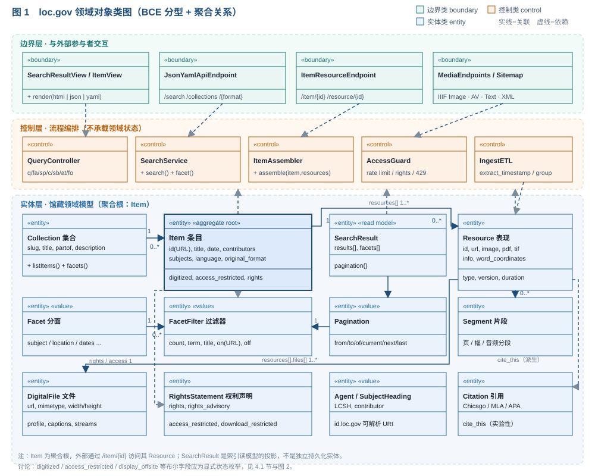
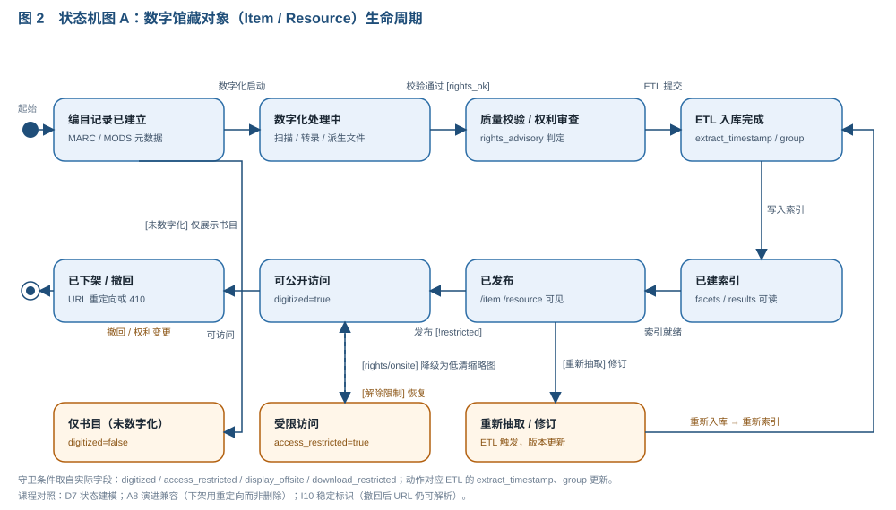
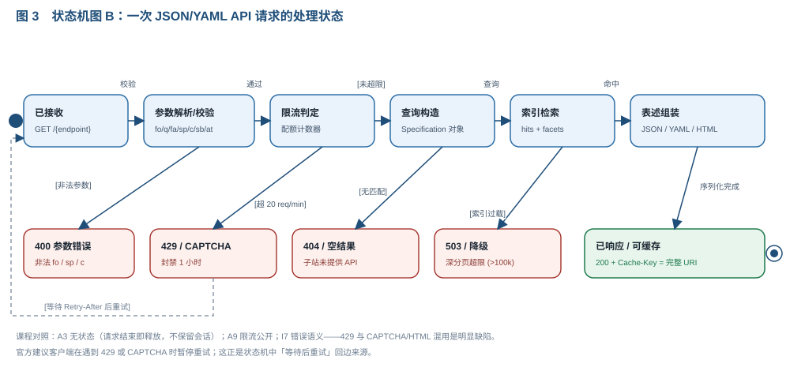
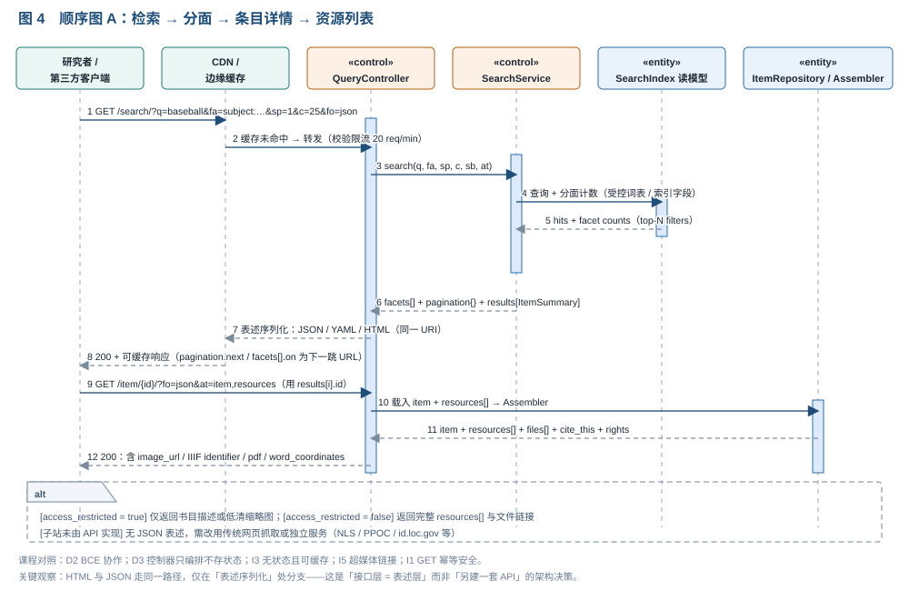
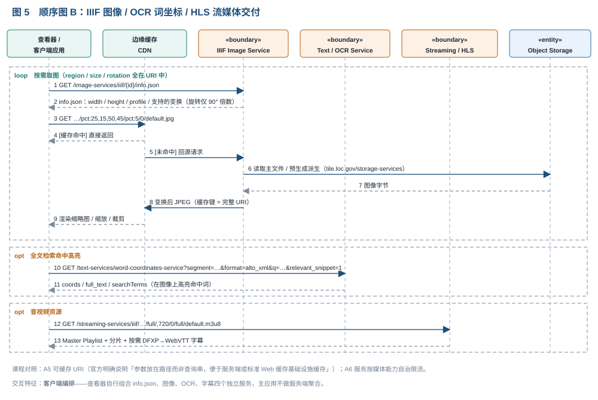
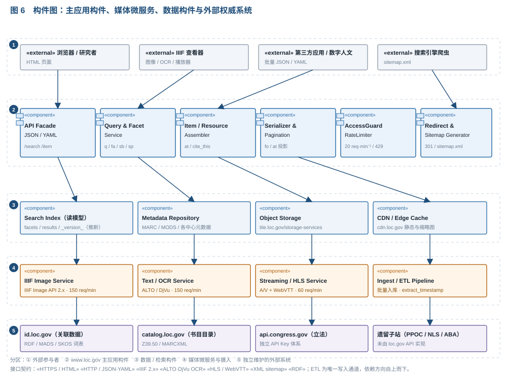
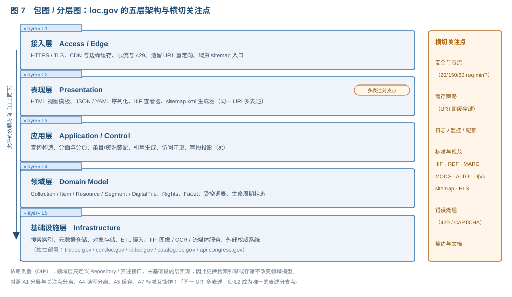
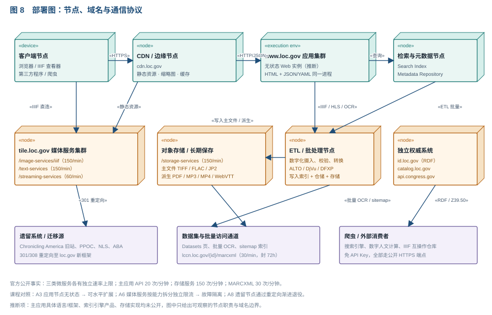

软件架构与面向对象建模 · 课程作业分析

# 美国国会图书馆网站（www.loc.gov）领域建模、应用架构与接口层设计分析

对照「领域对象建模 / 系统应用架构设计 / 接口层设计」的原则、要求与案例，含 8 张 UML 视图、软件架构体系判定与设计模式映射

分析对象：[https://www.loc.gov/](https://www.loc.gov/)（含官方 API 文档与公开技术公告）　|　资料核查日期：2026-11-13　|　图示：8 张（类图 1、状态图 2、交互图 2、构件图 1、包/分层图 1、部署图 1）

> **摘要。**loc.gov 不是一般的「内容管理网站」，而是一个**以馆藏数字对象为中心、以资源化 URL 为统一契约、由「一个主应用 + 一组按媒体能力拆分的微服务 + 多个独立权威数据系统」构成的联邦式数字图书馆平台**。其最鲜明的架构特征是：网站页面与机器接口**共用同一套 URL**（`?fo=json` 切换表述），馆藏按 `Collection → Item → Resource → Segment → File` 四级聚合组织，媒体交付统一走 `tile.loc.gov` 上的 IIIF 风格微服务，检索引擎与元数据仓储通过 ETL 形成读写分离的读模型。对照课程三类原则，它在**资源化接口、无状态、可缓存、分层与关注点分离、标准互操作**上做得很扎实；在**接口契约稳定性、错误表述一致性、显式状态建模、统一网关与版本化**上存在明显欠账。本报告以公开可验证的官方契约为主要依据，把「事实」与「推断」严格分开标注。

- [0　分析方法、边界与证据分级](#c0)
- [1　业务域、站点范围与关键事实](#c1)
- [2　课程原则对照框架（三类）](#c2)
- [3　领域对象建模与类图（图 1）](#c3)
- [4　状态图（图 2 / 图 3）](#c4)
- [5　交互图／顺序图（图 4 / 图 5）](#c5)
- [6　构件图（图 6）](#c6)
- [7　软件架构体系：分层与包图（图 7）](#c7)
- [8　部署视图（图 8）](#c8)
- [9　软件架构风格判定](#c9)
- [10　设计模式映射（20 项）](#c10)
- [11　逐条对照矩阵与差距清单](#c11)
- [12　改进建议与结论](#c12)
- [13　参考资料](#c13)

<a id="c0" name="c0"></a>

## 0　分析方法、边界与证据分级

本题要求「对照今天课程内容」分析一个真实运行的大型网站。由于课件原文未随题目提供，本报告采用软件工程 / OOAD 课程中通行的三类原则清单（见第 2 章）作为对照基准，**每条原则都写成可核对的「要求」**，再拿 loc.gov 的公开契约逐条比对。若课堂使用的条目名称或编号不同，只需替换矩阵首列，证据与结论仍可复用。

**方法** 采用**黑箱逆向建模 + 公开契约驱动**：以官方 API 文档、URL 结构、响应 JSON 结构、速率限制说明、迁移公告为输入，反推领域对象、构件边界、状态与交互；不臆测未公开的内部源码。

**事实** 来自 loc.gov 官方文档、官方文档中的示例 JSON/XML/URL、官方新闻稿与迁移公告，可直接引用。

**推断** 由可观察事实（字段名、深分页限制、历史技术资料、URI 形态）推得的内部实现判断，**不作为确定结论**，仅用于架构讨论。

**建议** 依据课程原则给出的规范性评价与改进设想，属分析者观点。

> **一个重要边界：**官方明确说明「部分子站并未由 loc.gov API 实现」（NLS、Publishers、Cataloging and Acquisitions、Research Rooms、American Folklife Center、Prints & Photographs Online Catalog 等），且另有 `catalog.loc.gov`、`id.loc.gov`、`api.congress.gov` 等独立系统。因此本报告的领域模型针对**「数字馆藏主站 + 其 API 与微服务」**，而不是整个 LOC 的全部信息系统。

### 图示清单（满足 5+ 要求）

| 编号 | UML 视图 | 建模对象 | 对应课程知识点 |
|---|---|---|---|
| 图 1 | 类图（BCE + 领域模型） | Collection / Item / Resource / Segment / DigitalFile 及边界类、控制类 | 领域对象识别、职责分配、聚合根、关联多重性、高内聚低耦合 |
| 图 2 | 状态机图 A | 数字馆藏对象从编目到发布、受限、下架的生命周期 | 状态、事件、守卫条件、动作；状态建模替代布尔标志组合 |
| 图 3 | 状态机图 B | 一次 API 请求在限流—校验—检索—组装—缓存中的状态 | 接口层状态、异常分支、无状态服务 |
| 图 4 | 顺序图 A | 检索 → 分面 → 条目详情 → 资源列表（HTML/JSON 双表述） | 交互建模、边界/控制/实体协作、消息序列 |
| 图 5 | 顺序图 B | IIIF 图像、OCR 词坐标、HLS 流媒体与字幕交付 | 客户端编排、可缓存 URI、微服务交互 |
| 图 6 | 构件图 | 主应用构件、索引/仓储/对象存储、三类微服务与外部系统 | 构件接口（provided/required）、依赖方向、接口隔离 |
| 图 7 | 包图 / 分层图 | 接入层—表现层—应用层—领域层—基础设施层 | 分层架构、依赖倒置、横切关注点 |
| 图 8 | 部署图 | www / tile / cdn / id / catalog / api.congress.gov 节点与协议 | 物理架构、分布与伸缩、故障隔离 |

<a id="c1" name="c1"></a>

## 1　业务域、站点范围与关键事实

### 1.1 业务目标与领域边界

LOC 的数字馆藏平台承担四类职责：**发现**（搜索、分面浏览、目录与关联数据）、**交付**（图像、OCR、音视频、PDF、网页存档）、**复用**（免密钥 API、IIIF 标准、引用生成、批量数据集）、**长期保存**（主文件、派生文件、编目元数据、受控词表）。官方文档对 API 价值的四条说明——自动化、结构化数据、分页遍历、更灵活的分面过滤——恰好对应「机器可读的领域模型对外暴露」这一架构目标。

### 1.2 官方公开的 API 体系

**事实** 官方把对外接口分为三类：**JSON/YAML for loc.gov**、**Sitemaps**、**Microservices**；另有「独立维护的 Additional APIs and Data Services」（Congress.gov API、NLS BARD、Chronicling America、PPOC JSON HTTP API、Linked Data Service、Search/Retrieval via URL）。微服务再分为 **Text Services / Image Services / Streaming Services** 三类，官方定义为「为特定职责编写、使用轻量 API 的有限用途计算机系统」。

| 主机 / 命名空间 | 职责 | 可验证的契约示例 |
|---|---|---|
| `www.loc.gov` | 主应用：HTML 页面 + JSON/YAML 表述；搜索、集合、格式、条目、资源端点 | `/search/?q=baseball&fo=json`、`/collections/civil-war-maps?fo=json`、`/item/2014717546/?fo=json`、`/resource/20001931/1918-04-05/ed-1/?fo=json` |
| `tile.loc.gov` | 媒体微服务与对象存储：IIIF 图像、OCR 文本、A/V 流、原始/派生文件 | `/image-services/iiif/{id}/full/pct:5/0/default.jpg`、`/text-services/word-coordinates-service?...&full_text=1`、`/streaming-services/iiif/.../full/full/0/full/default.m3u8`、`/storage-services/...` |
| `cdn.loc.gov` | 静态资源与缩略图 CDN | item 的 `image_url` 示例 `//cdn.loc.gov/service/pnp/.../0004f_150px.jpg` |
| `id.loc.gov` | 关联数据：权威与书目元数据、受控词表、每个词表值都有可解析 URI（RDF/MADS/SKOS） | Linked Data Service，Swagger 文档；**不**提供实体馆藏 |
| `catalog.loc.gov` | 2025-06-30 上线的 LC Catalog，替代旧目录系统，独立检索入口 | 官方博客：面向全部研究中心藏品的检索与发现 |
| `loc.gov/sitemap.xml` | 分层站点地图索引（portal → 子 portal → urlset），供爬虫批量发现 | 叶子 `urlset` 含 `loc / changefreq / priority` |

### 1.3 领域对象的层次（从响应结构反推）

```
Collection（集合，如 civil-war-maps、abraham-lincoln-papers）
   └── Item（书目条目 / 聚合根，如 /item/2014717546/）
         ├── 书目字段：title, date, contributors, subjects, language, location,
         │            original_format, online_format, partof, rights_advisory ...
         ├── 状态标志：digitized, access_restricted, display_offsite, download_restricted
         └── Resource（一次数字化表现，如报纸某一期 /resource/{id}/）
               ├── Segment（页 / 地图幅 / 音频分段，见 segments、hassegments）
               └── files[]（派生文件：iiif / pdf / tif / audio / video / captions
                            / word_coordinates / fulltext_file / djvu_text_file ...）

SearchResult（读模型）= facets[] + pagination{} + results[ItemSummary]
Facet → filters[]（count / title / on / off / term）  ← 自带下一跳 URL
```

**事实** 官方文档明确：「`Item` 可由一个或多个 `Resource` 组成」，「报纸的单个页面是 `Resource` 的 `Segment`，图集的 `Segment` 是单幅地图」，「`resources` 提供离散元素或表示的链接」，「`files` 是该资源数字表示的文件列表」。这正是课程中「聚合（Aggregation）/ 组合（Composition）与多重性」的教科书案例。

> **值得单独记一笔：**官方把 `/search/`、`/collections/`、`/{format}/` 三类端点统一归为「Search Result Endpoint」，因为它们**共享同一响应结构**（`facets / pagination / results`）；`/item/` 与 `/resource/` 共享另一种结构（`item / resources / cite_this / page / segments`）。这是接口层「同一类资源统一契约」原则的直接体现，也是后面构件图把「表述组装器」独立成构件的原因。

<a id="c2" name="c2"></a>

## 2　课程原则对照框架（三类）

下表把课堂常见的「原则 / 要求」整理成可核对的检查项，第 11 章将用它逐条打分。

### 2.1 领域对象建模

| 编号 | 原则 | 要求（可核对） |
|---|---|---|
| D1 | 领域概念识别 | 从业务语汇中抽取实体，命名与业务一致，避免以数据库表/页面代替领域对象 |
| D2 | BCE / 边界-控制-实体 | 类按职责分型；边界类负责交互、控制类负责流程编排、实体类承载业务数据与行为 |
| D3 | GRASP 信息专家与职责分配 | 职责落在拥有所需信息的类上；控制器不承载领域逻辑 |
| D4 | 高内聚 / 低耦合 / 单一职责 | 类与构件只因一个变化原因而改；依赖尽量单向 |
| D5 | 聚合根、关联与多重性 | 明确聚合边界、生命周期归属、1..* / 0..* 关系；外部只通过根访问内部对象 |
| D6 | 标识与值对象 | 实体有稳定唯一标识；可互换的描述性值建模为值对象 / 受控词表 |
| D7 | 状态与生命周期建模 | 有生命周期的对象用显式状态、事件、守卫条件描述，避免散落布尔标志 |
| D8 | 模型与存储分离 | 领域模型不绑定索引文档/表结构；异构数据源经适配与装配统一 |

### 2.2 系统应用架构设计

| 编号 | 原则 | 要求（可核对） |
|---|---|---|
| A1 | 分层与关注点分离 | 表现、应用、领域、基础设施分层；依赖方向一致，不出现跨层环依赖 |
| A2 | 构件化与接口隔离 | 构件通过明确 provided / required 接口协作，内部实现可替换 |
| A3 | 无状态与水平扩展 | 请求不依赖会话状态，可任意路由到实例；状态外置到索引/存储 |
| A4 | 读写分离 / 读模型 | 高频查询走为查询优化的索引，写入与 ETL 不阻塞读路径 |
| A5 | 缓存与边缘加速 | 幂等、可寻址的资源使用 CDN / 代理缓存；缓存键体现在 URI 中 |
| A6 | 服务自治与故障隔离 | 按能力拆分的服务独立限流、独立伸缩，单点故障不拖垮整体 |
| A7 | 标准与互操作 | 采用领域标准（IIIF、RDF、MARC/MODS、sitemap），避免私有协议 |
| A8 | 演进式迁移与兼容 | 遗留系统渐进替换，保留 URL 重定向与契约兼容 |
| A9 | 安全、限流与可观测 | 限流、错误码、日志、配额公开；防止拒绝服务 |

### 2.3 接口层设计

| 编号 | 原则 | 要求（可核对） |
|---|---|---|
| I1 | 资源化与统一接口 | URI 标识资源而非动作；HTTP 方法语义正确（GET 安全且幂等） |
| I2 | 表述协商 | 同一资源可返回多种表述（HTML / JSON / YAML），最好走标准 Accept 协商 |
| I3 | 无状态与可缓存 | 请求自含全部上下文；响应可缓存，缓存键在 URI 中 |
| I4 | 分页、过滤、排序、投影 | 提供稳定分页、分面过滤、排序、字段裁剪能力，并有明确上限 |
| I5 | 超媒体与可发现性 | 响应自带下一跳链接（next / facet on / item url），客户端无需硬编码 |
| I6 | 契约稳定性与版本化 | 字段结构、类型、取值有正式契约；破坏性变更有版本策略 |
| I7 | 一致的错误与限流语义 | 错误统一为机器可读表述与标准状态码，含重试提示 |
| I8 | 安全与开放平衡 | 最小必要认证；公开数据免密，但需配额、节流与滥用防护 |
| I9 | 文档与示例代码 | 端点、参数、响应、限制、示例完整公开 |
| I10 | 标识一致性 | 标识符稳定、规范、与传输协议一致（如统一 HTTPS） |

<a id="c3" name="c3"></a>

## 3　领域对象建模与类图（图 1）

### 3.1 建模思路

**BCE** 以课程案例常用的「边界类—控制类—实体类」三分法组织：**边界类**是浏览器页面、JSON/YAML 端点、Sitemap、IIIF 端点；**控制类**是查询控制器、检索服务、条目装配器、访问/限流守卫、ETL 入库控制器；**实体类**是馆藏领域对象。这样可以直接把「接口层设计」与「领域建模」两部分的对照结论挂到同一张图上。



**图 1　类图。**实体层给出 12 个领域类与关键属性，控制层 5 个、边界层 4 个；实线为关联（标注多重性），虚线为依赖。`Collection 1 — 0..* Item 1 — 0..* Resource 0..* Segment` 构成聚合链，`Resource 1..* DigitalFile` 是组合关系；`SearchResult` 由 `Facet / FacetFilter / Pagination / ItemSummary` 组成，是典型的读模型值对象集合。

### 3.2 逐条对照（领域对象建模）

| 原则 | loc.gov 中的体现（证据） | 评价 | 说明 |
|---|---|---|---|
| D1 | **事实** 官方术语直接成为资源名与字段名：Collection、Item、Resource、Segment、File、Facet、Contributor、Subject、Rights；「报纸是 Item、期是 Resource、页是 Segment」的语义边界非常清楚。 | **符合** | 领域语汇与业务（编目、馆藏）一致，未见以页面/表命名领域对象。 |
| D2 | **推断** 端点 / 视图 = 边界；查询构造、装配、限流 = 控制；Item/Resource = 实体。可由「同一 URL 输出 HTML 或 JSON」反推视图与模型分离。 | **符合** | 是 BCE 分型的良好案例：表述可换而领域对象不变。 |
| D3 / D4 | **事实** `cite_this`、`pagination`、`facets` 各由独立响应属性承担；`fo / at / q / fa / sp / c / sb` 参数职责互不重叠。 | **符合** | 参数级单一职责；但 `item` 内再嵌一个「结构因集合而异」的 `item` 字段，是职责越界的苗头。 |
| D5 | **事实** 官方明确 Item 由 1..* Resource 组成，Resource 有 `segments` 与 `files[]`；`hassegments` 标志是否存在细分。 | **符合** | 聚合边界与多重性可直接从契约读出，适合课堂案例复刻。 |
| D6 | **事实** `id` 为「HTTP 形式的完整 URL」，`aka` 为替代标识；LCSH / 受控词表由 `id.loc.gov` 提供可解析 URI。 | **部分** | 标识稳定且可解析；但官方文档承认 id 仍为 `http://` 而站点仅支持 HTTPS，属历史遗留（见 I10）。 |
| D7 | **事实** `digitized` / `access_restricted` / `display_offsite` / `download_restricted` 均为布尔标志；`extract_timestamp`、`group` 记录 ETL 来源。 | **较弱** | 缺少显式状态枚举，布尔组合会产生非法状态（如未数字化却可下载）。图 2 给出规范化重构。 |
| D8 | **事实** 官方说明 item 元数据「来自各研究中心提供的多种元数据格式」，另有 MARCXML、MODS、ALTO XML、DjVu XML、DFXP→WebVTT 转换。 | **符合** | 典型「适配 + 装配」，领域模型与异构数据源解耦；代价是字段一致性依赖 ETL 治理。 |

<a id="c4" name="c4"></a>

## 4　状态图（图 2 / 图 3）

### 4.1 数字馆藏对象的生命周期（图 2）

**课程要求** 状态图要给出**状态、事件、守卫条件、动作**四要素，并用以约束对象的合法行为。loc.gov 的响应中散落着 `digitized`、`access_restricted`、`display_offsite`、`download_restricted`、`extract_timestamp`、`group` 等字段，正好可以还原出一条完整生命周期。下图把它们规范化为显式状态机（**建议** 部分为对现有实现的重构表达，并非官方公开的状态机）。



**图 2　状态机图 A。**上半行是「生产侧」（编目 → 数字化 → 权利审查 → ETL 入库），下半行是「服务侧」（索引 → 发布 → 访问 → 撤回），橙色为三个重要的分支/回流状态。官方并未公布这张状态机，它是依据响应字段与迁移公告还原的**规范化模型**：**建议** 用 `status` 枚举替代四个布尔标志，可消除「未数字化却可下载」这类非法组合。

### 4.2 一次 API 请求的处理状态（图 3）

**事实** 官方《Working Within Limits》给出可核对的状态与异常：JSON/YAML API **20 次/分钟**，文本/图像服务 **150 次/分钟**，流媒体 **60 次/分钟**，`/storage-services/` **150 次/分钟**；超限**封禁 1 小时**（MARCXML 为 72 小时且封禁期内请求会重置倒计时）；高负载时可能返回 **429** 或**带 CAPTCHA 的 HTML 页面**。深分页上限 **100,000 条**，每页建议不超过 **1,000 条**。



**图 3　状态机图 B。**把接口层处理流程显式化为状态，可清楚看到课程强调的「异常分支必须和正常分支同等建模」。**事实** 限流数值与封禁时长来自官方限制页；**推断** 「查询构造 / 表述组装」等中间状态由参数语义与响应结构推得。

<a id="c5" name="c5"></a>

## 5　交互图／顺序图（图 4 / 图 5）

### 5.1 检索 → 分面 → 条目详情（图 4）

**事实** 一次典型的机器访问路径为：`/search/?q=…&fo=json` 得到 `results[] / facets[] / pagination`；用 `results[i].id` 再请求 `/item/{id}/?fo=json&at=item,resources` 取完整元数据与资源文件；响应里的 `pagination.next / previous / last` 与 `facets[i].filters[j].on / off` 本身就是下一跳 URL。



**图 4　顺序图 A。**1–8 为一次检索，9–12 为一次条目详情；虚线为返回消息，蓝色激活条标出对象活跃期，底部 `alt` 框覆盖权限受限与「子站未提供 API」两种分支。图中所有 URL 与字段名均取自官方文档。

### 5.2 图像 / OCR / 音视频交付（图 5）

**事实** 图像服务实现 **IIIF Image API**，基础 URI 为 `https://tile.loc.gov/image-services/iiif/{identifier}`，完整形式 `/{region}/{size}/{rotation}/{quality}.{format}`；`info.json` 返回可用格式、质量与支持的变换（旋转仅支持 90° 倍数）。文本服务以 `segment + format` 为最小参数，支持 `alto_xml / djvu_xml / djvu_json / plain_text`、`full_text=1`、`q + relevant_snippet=1` 高亮、`byte_range`。流媒体服务复用 IIIF 路径风格，加入 `{temporal_region}`，输出自适应 **HLS**（`.m3u8` 主从播放列表）与按需 **WebVTT** 字幕转换。



**图 5　顺序图 B。**三个 `loop / opt` 片段分别对应图像、OCR 高亮、音视频三条可独立发生的交互。**事实** 官方流媒体文档特别强调「把请求信息放在路径段而非查询参数中，使响应更易被标准 Web 缓存缓存，甚至可用预计算文件的最小实现」——这是课程「可缓存接口设计」极佳的真实案例。

<a id="c6" name="c6"></a>

## 6　构件图（图 6）

**课程要求** 构件图要区分 **provided interface（提供）** 与 **required interface（需求）**，并让依赖方向单向、可替换。下图按「外部参与者 → 主应用构件 → 微服务与数据构件 → 独立外部系统」四层组织；组件之间标注的是**契约**而不是函数调用。



**图 6　构件图。**六个主应用构件共享一个 API 门面；数据/检索构件与三类媒体微服务各自独立伸缩、独立限流；`Ingest / ETL Pipeline` 是唯一的写入通道，形成清晰的读写分离。**推断** 「Search Index」具体实现未公开，`_version_` 字段与「深分页导致内存增长」的描述与 Lucene/Solr 类引擎特征一致，但仅作为架构推断。

| 构件 | Provided（对外提供） | Required（依赖） |
|---|---|---|
| API Facade | `/search/ /collections/ /{format}/ /item/ /resource/`，HTML / JSON / YAML | Query&Facet、Assembler、Serializer、AccessGuard |
| Query & Facet Service | 检索、分面统计、排序、日期范围 | Search Index（读模型） |
| Item / Resource Assembler | `item / resources[] / files[] / segments / cite_this` | Metadata Repository、Object Storage、Rights 策略 |
| Serializer & Pagination | `fo` 表述切换、`at` 字段投影、`pagination.next/previous/last` | 领域对象、分页策略 |
| IIIF Image / Text / Streaming | IIIF Image 2.x、词坐标 API、HLS 播放列表 | Object Storage 中的主文件与派生文件 |
| Ingest / ETL | 批量入库、索引更新、格式转换 | 各研究中心元数据（MARC/MODS/ALTO/DjVu/DFXP） |

<a id="c7" name="c7"></a>

## 7　软件架构体系：分层与包图（图 7）



**图 7　包图 / 分层图。**把第 6 章的构件按课程的分层原则重新组织：L1 接入、L2 表现、L3 应用、L4 领域、L5 基础设施，右侧为贯穿所有层的横切关注点。箭头表示允许的依赖方向，不允许反向或跨层环依赖。

<a id="c8" name="c8"></a>

## 8　部署视图（图 8）



**图 8　部署图。**节点按域名与职责划分。`www.loc.gov` 承担应用与 API，`tile.loc.gov` 承担全部媒体与文件服务，`cdn.loc.gov` 承担静态加速；`id.loc.gov / catalog.loc.gov / api.congress.gov` 属于独立部署边界。2025 年 Chronicling America 旧站通过 URL 重定向并入新框架，是演进式迁移的真实证据。

<a id="c9" name="c9"></a>

## 9　软件架构风格判定

> #### 它不是什么
>
> - 不是典型的「业务微服务」拆分（没有按用户/订单/库存等领域限界上下文拆服务）；
> - 不是纯静态站点生成器，也不是简单的 CMS；
> - 不是单一 RESTful 后端 + SPA 前端，HTML 由服务端渲染；
> - 也不是完全统一的平台——多个子站与目录系统明确在 API 边界之外。

> #### 它是什么
>
> - **资源导向的分层 Web 应用**：URI 即领域对象地址，HTTP GET 即访问；
> - **「API 即网站」双表述架构**：同一端点服务人与机器；
> - **边缘微服务 / 按媒体能力拆分**：图像、OCR、流媒体各自独立；
> - **读写分离 + 读模型**：ETL 写入，索引服务查询；
> - **联邦式系统集成**：关联数据、目录、立法 API 各自独立，用 URL 互相引用。

### 9.1 六个关键架构决策及其取舍

| 决策 | 证据 | 收益 / 代价 |
|---|---|---|
| 同一 URL 输出 HTML 与 JSON/YAML | 官方：「API 最初就是为驱动 loc.gov 网站而设计，除提供 HTML 外还能提供 JSON」；任意由 API 实现的页面加 `?fo=json` 即可暴露结构 | 收益：无第二套 API、URL 永久有效、引用与机器读取一致；代价：网页改版会牵动 API 契约，`item` 内嵌字段随集合变化 |
| 资源化 URI 而非动作式 RPC | `/search/ /collections/{slug}/ /{format}/ /item/{id}/ /resource/{id}/`；IIIF 把 region/size/rotation 全放进路径 | 收益：可缓存、可引用、可被爬虫与外部系统复用；代价：复杂查询靠参数组合，表达能力弱于 GraphQL |
| 搜索引擎读模型 + ETL 写通道 | `extract_timestamp`、`group` 记录 ETL；「深分页越深内存越大」「100,000 条上限」；分面计数来自索引 | 收益：海量馆藏的高性能分面检索；代价：读写一致性延迟，字段一致性依赖 ETL 治理 |
| IIIF 标准与媒体微服务 | Image Services 实现 IIIF Image API；Streaming Services 复用 IIIF 路径风格；`info.json` 自描述能力 | 收益：跨馆互操作、查看器可替换、URL 即缓存键；代价：客户端要自行编排多个服务 |
| 免认证开放 + 粗粒度限流 | 「no API key or authentication required」；20/150/60 次每分钟，超限封禁 1 小时 | 收益：零门槛、利于教学与科研；代价：无法按调用方计量，超限返回 CAPTCHA/HTML 破坏机器契约 |
| 渐进式迁移与绞杀者模式 | 2025-08-04 Chronicling America 并入 loc.gov 数字馆藏框架，旧 URL 永久重定向；2025-06-30 新 LC Catalog 上线替代 25 年旧系统 | 收益：不中断引用链接、可逐块替换；代价：多套系统长期并存，API 覆盖面不一致 |

> **关于技术栈的诚实说明：**公开的《Collections as Data》最终报告提到 NDNP/Chronicling America **旧站**使用 Python + Django 且代码开源；第三方资料也提到 Solr 索引。响应中的 `_version_` 字段与「深分页内存增长」描述确实符合 Lucene/Solr 系引擎特征。但 **loc.gov 主站当前实现并未公开**，因此本报告把这些标为 **推断**，在架构判定中只用可观察契约说话，不把「Django + Solr」当作既定事实。

<a id="c10" name="c10"></a>

## 10　设计模式映射（20 项）

下表把课程常讲的 GoF / 架构模式逐项挂到 loc.gov 的可观察证据上；「代价」一栏用于课堂讨论，避免把模式当成无条件的好东西。

| # | 模式 | 课程原则 | loc.gov 中的落点（证据 / 推断） | 效果与代价 |
|---|---|---|---|---|
| 1 | **MVC / Model 2** | A1 D2 | 同一 Controller 依据 `fo` 选择 HTML 视图或 JSON/YAML 序列化；Model 是 Item/Resource 领域对象 | 模型复用最大化；视图与控制器耦合于参数约定 |
| 2 | **Front Controller** | A1 I1 | 统一入口路由 `/{endpoint}/{id}/`，再分发到 search / collections / item / resource 处理器 | 集中处理限流、校验、重定向；单点需保证高可用 |
| 3 | **Facade（API 门面）** | A2 I1 | JSON/YAML API 一个门面封装索引查询、元数据读取、装配、引用生成、分页 | 客户端不必知道内部构件；门面易变成「上帝接口」（属性多达 20+） |
| 4 | **Repository** | D8 A1 | `ItemRepository` 屏蔽索引 / 元数据仓储 / 对象存储三种数据源（推断的控制类） | 领域层不依赖存储；需处理读模型与权威数据的一致性 |
| 5 | **Data Mapper / DTO / Assembler** | D8 | 官方说明 item 元数据来自 MARC/MODS 等多种格式，统一装配为 `item`；`results[]` 是 `ItemSummary` 投影，`at=item,resources` 才取全量 | 异构数据统一；映射规则复杂，字段跨集合不一致 |
| 6 | **Adapter** | D8 A7 | ALTO XML / DjVu XML / plain_text → 统一词坐标 API；DFXP → WebVTT；MARCXML → 书目；IIIF 规范适配多个查看器 | 标准互操作；适配器数量随格式增长 |
| 7 | **Strategy** | A1 I2 | `fo=json \| yaml \| html` 选择序列化策略；按 `online_format`（image/pdf/audio/video/web page）选择渲染器与播放器 | 新增表述不改领域代码；策略膨胀需注册表治理 |
| 8 | **Builder + Specification** | I4 D3 | `q + fa(管道分隔多条件) + dates + sp + c + sb + at` 组合成一条查询规格 | 表达力强且无状态；参数语法为自定义，非标准 |
| 9 | **Chain of Responsibility** | A9 I7 | 限流判定 → 参数校验 → 路由/重定向 → 查询 → 装配 → 序列化 → 缓存，任一环节可短路（图 3） | 横切关注点可插拔；错误表述在链尾易失控（429/CAPTCHA） |
| 10 | **Proxy + Cache-Aside / CDN** | A5 I3 | `cdn.loc.gov` 缩略图；IIIF 把全部参数放进路径以便标准 Web 缓存；`tile.loc.gov` 回源对象存储 | 大幅降低源站压力；缓存失效与版本控制需额外约定 |
| 11 | **Iterator + HATEOAS** | I4 I5 | `pagination` 自带 `first/next/previous/last`；`facets[].filters[].on/off` 自带下一跳 URL；`contributors` 值也是分面 URL | 客户端无需拼 URL；深分页受 100,000 限制，缺游标分页 |
| 12 | **Observer / 事件驱动 ETL** | A4 A8 | 批次入库触发索引更新；`extract_timestamp` / `group` 记录来源与最近一次 ETL | 读写解耦；最终一致，需要重放与去重（官方建议按 id 去重） |
| 13 | **Template Method** | A7 | 图像 URI `/{region}/{size}/{rotation}/{quality}.{format}` 与 A/V URI `…/{temporal_region}/{quality}.{format}` 复用同一套路径骨架 | 规范一致、学习成本低；A/V 只实现了部分参数（官方明示） |
| 14 | **Value Object / Flyweight** | D6 | `Facet / FacetFilter / Pagination / SubjectHeading` 为不可变值对象；LCSH 与受控词表由 `id.loc.gov` 统一提供可解析 URI | 共享词表省存储又统一语义；但 facet 值「并非受控词表，随分部编目字段而异」 |
| 15 | **Decorator / Policy Guard** | D7 I8 | `access_restricted`、`download_restricted`、`rights_advisory` 在交付前包装一层访问策略：仅书目 / 低清缩略图 / 完整文件 | 权利控制与业务逻辑分离；以布尔标志实现，缺显式状态机 |
| 16 | **Bridge** | D4 A2 | 抽象 `Item` 与「图像 / 报纸 / 音频 / 视频 / 网页存档」等多种 `online_format` 实现分离，各自有独立交付服务 | 新增媒体类型不改动领域模型；抽象泄漏体现在 `item` 内嵌字段随集合而变 |
| 17 | **CQRS-like 读模型** | A4 | 写侧 = ETL 入库（含 `extract_timestamp`），读侧 = 搜索索引的 `results / facets / pagination`；两类端点响应结构不同 | 查询性能与分面能力极强；读模型字段不完整，需再请求 `/item/` 补全 |
| 18 | **Bulkhead / 舱壁隔离** | A6 A9 | 主 API 20、文本/图像 150、流媒体 60、存储 150、MARCXML 30 次/分钟，各自独立封禁 1 小时（MARCXML 72 小时） | 某类媒体被刷不影响检索；配额粒度按服务而非调用方 |
| 19 | **Strangler Fig + ACL** | A8 | 2025 年把 Chronicling America 旧站整体迁入 loc.gov 数字馆藏框架，旧 URL 永久重定向；PPOC 等旧 API 保留为「Additional APIs」 | 链接不失效、可渐进替换；长期并存造成覆盖面不一致 |
| 20 | **Registry / Linked Data** | D6 A7 | `id.loc.gov` 为每个词表与每个值提供可解析 URI，作为全馆共享的权威注册中心（不提供实体馆藏） | 语义统一、跨系统可链接；主站 facet 值尚未完全接入受控词表 |

> **课堂讨论点：**模式 10/11/13 组合起来正好回答「为什么 IIIF 要把参数放路径而不是查询串」——官方给出的理由是**缓存友好 + 可用预生成文件的最小实现**。这是把「接口层设计原则」直接转化为「部署层性能收益」的完整证据链，很适合作为课程案例复述。

<a id="c11" name="c11"></a>

## 11　逐条对照矩阵与差距清单

评分口径：**符合** 有明确公开证据且做法规范；**部分** 方向正确但存在例外或不一致；**较弱** 与课程要求有明显偏差。

| 原则 | loc.gov 中的体现 | 评价 | 差距 / 说明 |
|---|---|---|---|
| D1 | Collection / Item / Resource / Segment / File 直接对应编目业务语汇 | **符合** | — |
| D2 | 端点与视图为边界、查询装配为控制、馆藏对象为实体 | **符合** | — |
| D3 | `fo/at/q/fa/sp/c/sb` 职责单一；控制器仅编排 | **符合** | `item.item` 内嵌字段承担了展示逻辑 |
| D4 | 三类微服务按媒体能力拆分，各自限流 | **符合** | 主应用响应对象属性过多（20+），门面偏胖 |
| D5 | Item 1..* Resource，Resource 0..* Segment / 1..* files | **符合** | `resources[]` 与 `item.resources` 存在重复表达 |
| D6 | id 为可解析 URL，aka 提供替代标识，词表由 id.loc.gov 注册 | **部分** | 官方承认 id 仍是 `http://` 而站点仅 HTTPS |
| D7 | 生命周期散落在 4 个布尔标志与 ETL 时间戳中 | **较弱** | 缺显式状态枚举；图 2 给出规范化方案 |
| D8 | 多格式元数据经 ETL 装配为统一 item 模型 | **符合** | 字段一致性依赖各分部编目实践 |
| A1 | 五层清晰，HTML/JSON 只在表述层分支 | **符合** | — |
| A2 | 构件通过 URL/IIIF/sitemap 等标准契约协作 | **符合** | 缺少正式机器可读契约（OpenAPI / JSON Schema） |
| A3 | GET 请求自含全部参数，无会话状态 | **符合** | — |
| A4 | ETL 写通道 + 索引读模型，分面统计来自索引 | **符合** | 读写一致性与字段完整性需二次请求补全 |
| A5 | CDN、IIIF 路径式参数、官方明确「便于标准 Web 缓存」 | **符合** | — |
| A6 | 文本/图像/流媒体/存储各自独立速率上限 | **符合** | — |
| A7 | IIIF、RDF/MADS/SKOS、MARC/MODS、ALTO/DjVu、sitemap、HLS | **符合** | — |
| A8 | 2025 年旧站整体迁移 + 永久重定向 + 后端检索升级 | **符合** | 遗留子站仍在 API 边界之外，长期并存 |
| A9 | 限流数值、封禁时长、深分页上限全部公开 | **部分** | 429 与 CAPTCHA/HTML 混用，机器不可读 |
| I1 | URI 标识资源；全部为 GET；IIIF 参数路径化 | **符合** | `fo` 以查询参数切换表述，接近 RPC 味道 |
| I2 | 同一 URL 可输出 HTML / JSON / YAML | **部分** | 主站依赖 `fo` 参数；仅旧 PPOC API 支持标准 `Accept` 协商 |
| I3 | 请求自含 q/fa/sp/c/sb/at；URI 即缓存键 | **符合** | — |
| I4 | 分页 `sp/c`、分面 `fa`、排序 `sb`、投影 `at / at!=`、日期 `dates` | **符合** | 深分页 100,000 上限，无游标/搜索后翻页 |
| I5 | `pagination.next/previous/last`、`facets[].filters[].on/off`、contributor 值即分面 URL | **符合** | 缺根发现文档与统一 link relation |
| I6 | 文档标注字段类型、可分面/可排序、示例齐全 | **较弱** | 无 API 版本；官方明言 `item.item` 字段「不要依赖其存在、类型或取值」；PPOC API 自称「随时会改」 |
| I7 | 429 状态码 + 官方建议客户端暂停重试 | **较弱** | 高负载时可能返回 HTML CAPTCHA；无统一错误 JSON / Retry-After 约定 |
| I8 | 免 API Key、全 HTTPS、公开配额 | **符合** | 无法按调用方计量，配额粒度粗 |
| I9 | 端点、参数、响应、限制、动态示例、教程齐备 | **符合** | — |
| I10 | item / resource URL 长期稳定，迁移保留重定向 | **部分** | id 字段协议头历史遗留为 http |

### 11.1 最值得写进作业的 7 条差距（按课程原则归类）

1. **D7 状态建模缺失。**`digitized / access_restricted / display_offsite / download_restricted` 四个布尔量会产生 16 种组合，其中若干组合在业务上非法。课程要求「有生命周期的对象用状态机描述」，图 2 即为修正。
2. **I6 契约稳定性不足。**官方文档明确提醒 `item` 内嵌字段「因收藏部门编目实践而异，不要依赖其存在、数据类型或取值」；同时部分分面值「不是受控词表，来自各分部编目字段」。这是领域模型一致性（D8）与接口契约（I6）的双重漏洞。
3. **I7 错误表述不一致。**官方写明高负载时「可能遇到 429 状态码或带 CAPTCHA 的 HTML 页面」，即使未超限也可能出现。机器客户端拿到 HTML 时无法解析——违反「错误必须机器可读、语义统一」。
4. **I2 表述协商非标准化。**主站用 `fo=json` 查询参数，而旧 PPOC API 支持 `Accept: application/json` 内容协商。同一机构内两套做法，说明接口层规范未统一收口。
5. **I4 分页机制受索引限制。**「越深翻页内存越大」，100,000 条硬上限，每页建议 ≤1,000；官方不得不建议「按日期分面切分结果集后本地合并，并按 id 去重」。这是把索引实现约束泄漏到了接口层（A1 依赖倒置的反例）。
6. **A2 / A1 无统一网关与 BFF。**客户端要自己跨 `www / tile / cdn / id / catalog / api.congress.gov` 六个域名编排，图 5 的「客户端编排」既是解耦也是负担；且部分子站（NLS、ABA、PPOC、AFC）根本不提供 JSON 表述。
7. **I6 无版本策略。**URI 中没有 `/v1/`，破坏性变更只能靠参数兼容或新增字段，旧客户端缺乏迁移窗口；这与 A8「渐进迁移」形成对照——迁移做得好，版本治理没跟上。

<a id="c12" name="c12"></a>

## 12　改进建议与结论

| 优先级 | 建议 | 对应原则 | 可落地的做法 |
|---|---|---|---|
| P0 | 统一错误与限流契约 | I7 A9 | 所有端点返回结构化错误 JSON（`code / message / retry_after / docs_url`）；429 必带 `Retry-After`；机器人校验走独立通道，绝不向 API 客户端返回 HTML CAPTCHA |
| P0 | 显式状态机与状态枚举 | D7 | 用 `status: cataloged\|digitizing\|ingested\|indexed\|published\|restricted\|retired` 替代布尔组合；把守卫条件与事件固化为服务，前端只消费状态 |
| P1 | 契约固化与版本化 | I6 A2 | 发布 OpenAPI + JSON Schema；收敛 `item.item` 变体字段或显式标注为 `extensions`；引入 `/v1/` 或 media type 版本，旧表述保留一个弃用周期 |
| P1 | 标准内容协商 + 兼容层 | I2 | 支持 `Accept: application/json / application/yaml / text/html`，同时保留 `fo` 作为兼容别名；统一 id 为 HTTPS（I10） |
| P1 | 游标分页与批量导出 | I4 A4 | 提供 `cursor / search_after` 或异步导出任务，消除 100,000 深分页上限与客户端手动去重 |
| P2 | 统一网关 / BFF | A2 A1 | 用单一入口聚合 item + IIIF info + OCR 高亮，向查看器交付一份编排后的视图模型；同时对遗留子站加防腐层（ACL），逐步补齐 JSON 表述 |
| P2 | 受控词表统一分面 | D6 D8 | 把 facet 值映射到 `id.loc.gov` 的可解析 URI，跨分部统一 subject / contributor / location 取值，减少重复与歧义 |
| P2 | 标准化字段投影 | I4 I6 | 把 `at=item,resources.0.files` 这类自造语法收敛为标准的 sparse fieldset 或 GraphQL 层，保留旧参数为兼容别名 |

### 结论

> 从课程三类原则看，**loc.gov 是一个「领域模型清晰、分层与构件化到位、接口层资源化与可缓存性极佳，但契约治理偏弱」的大型公共数字平台**。
>
> ① **领域对象建模**：四级聚合 `Collection → Item → Resource → Segment/File` 边界清楚、多重性可直接从 API 文档读出，BCE 分型与职责分配堪称教学级案例；短板是生命周期用布尔标志而非状态机（图 2 给出修正）。
>
> ② **系统应用架构设计**：五层架构 + 读写分离读模型 + 按媒体能力拆分的边缘微服务 + 独立权威数据系统，配合 CDN 与标准协议，在可伸缩性、故障隔离、互操作与演进式迁移上表现优秀（图 6/7/8）；短板是缺少统一网关，客户端需跨域编排，部分子站不在同一契约内。
>
> ③ **接口层设计**：「同一 URI 两种表述、全部 GET、参数自含、URI 即缓存键、分页与分面自带下一跳链接」几乎是 REST 原则的正面范例；短板集中在无版本、错误表述不统一（429 与 CAPTCHA/HTML 混用）、非标准表述协商、深分页上限泄漏实现细节。
>
> 综合而言，它更适合作为课程中「**资源导向架构 + 标准互操作 + 渐进迁移**」的正面案例，以及「**契约稳定性与状态建模**」的反面讨论材料。

<a id="c13" name="c13"></a>

## 13　参考资料

以下均为官方公开资料（除注明外），访问 / 核查日期：2026-11-13。文中所有 URL、字段名、速率数值、迁移时间均引自这些来源。

1. Library of Congress, [APIs for LoC.gov](https://www.loc.gov/apis/)（三类 API 总览、JSON API / Sitemaps / Microservices 定义）
2. [Making API Requests](https://www.loc.gov/apis/json-and-yaml/requests/)（`?fo=json`、base URL、未被 API 实现的子站清单）
3. [API Endpoints](https://www.loc.gov/apis/json-and-yaml/requests/endpoints/)（search / collections / format / item / resource 端点与响应结构）
4. [API Request Parameters](https://www.loc.gov/apis/json-and-yaml/requests/parameters/)（fo / at / q / fa / c / sp / sb 参数与取值）
5. [Search Results Responses](https://www.loc.gov/apis/json-and-yaml/responses/search-results/)（facets / pagination / results 结构）
6. [Item and Resource Responses](https://www.loc.gov/apis/json-and-yaml/responses/item-and-resource/)（item 字段表、resources / files / segments 结构）
7. [Working Within Limits](https://www.loc.gov/apis/json-and-yaml/working-within-limits/)（速率上限、封禁时长、深分页 100,000、每页 1,000、分面切分与去重建议）
8. [Image Services](https://www.loc.gov/apis/micro-services/image-services/)（IIIF Image API URI、info.json、region/size/rotation/quality/format）
9. [Text Services](https://www.loc.gov/apis/micro-services/text-services/)（词坐标、full_text、byte_range、relevant_snippet、ALTO/DjVu）
10. [Streaming Services](https://www.loc.gov/apis/micro-services/streaming-services/)（IIIF-like A/V URI、HLS 播放列表、WebVTT 字幕、路径参数便于缓存）
11. [Sitemaps](https://www.loc.gov/apis/sitemaps/)（分层 sitemapindex / urlset 结构）
12. [Linked Data Service](https://www.loc.gov/apis/additional-apis/linked-data-service/)（id.loc.gov、受控词表与可解析 URI）
13. [Prints and Photographs Online Catalog API](https://www.loc.gov/pictures/api)（旧 API 的 `Accept` 内容协商与「随时可能变更」声明）
14. [Chronicling America Website Migration](https://www.loc.gov/ndnp/migration)（2025-08-04 迁移、统一数字馆藏框架、URL 重定向策略）
15. Library of Congress Newsroom, [Major Upgrades to Chronicling America Website](https://newsroom.loc.gov/news/national-book-festival-offers-free-activities-for-readers-of-all-ages/s/news/library-of-congress-unveils-major-upgrades-to-chronicling-america-website/s/5e0ef838-0fbe-4c6a-b810-476fbfc94a55)（升级内容与后端检索基础设施）
16. Library of Congress Blog, [Mapping the Way through the New Catalog](https://blogs.loc.gov/maps/2025/07/mapping-the-new-catalog/)（2025-06-30 新 LC Catalog 上线）
17. [www.loc.gov 首页](https://www.loc.gov/)（站点入口与资源域名 `tile.loc.gov` / `cdn.loc.gov` 的实际使用）
18. IIIF Consortium, [IIIF Image API 2.0](https://iiif.io/api/image/2.0/)（URI 语法规范）
19. *Always Already Computational: Collections as Data — Final Report*（NDNP/Chronicling America 旧站采用 Python + Django 的历史说明，**非主站实现证据**）

---

说明：本报告为课程分析作业，采用公开可验证资料进行黑箱逆向建模；所有「推断」与「建议」均已标注，不代表美国国会图书馆官方架构说明。图 1–图 8 为依据公开契约绘制的分析性 UML 视图。
